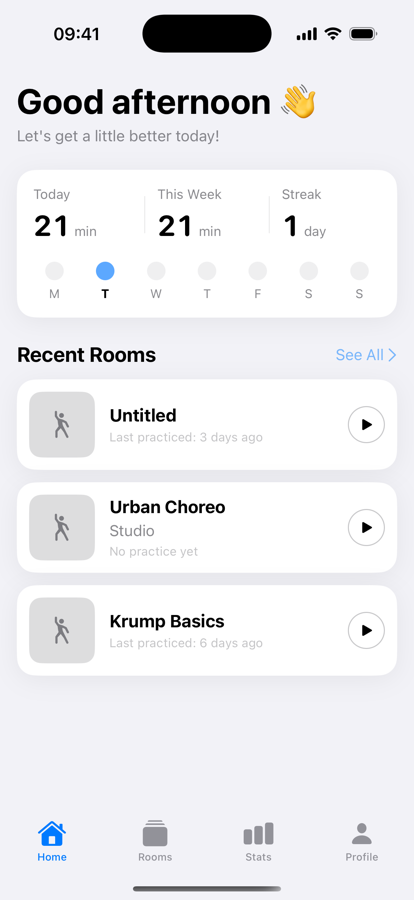
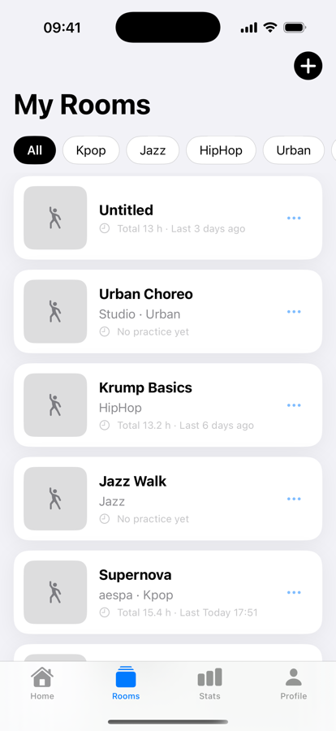
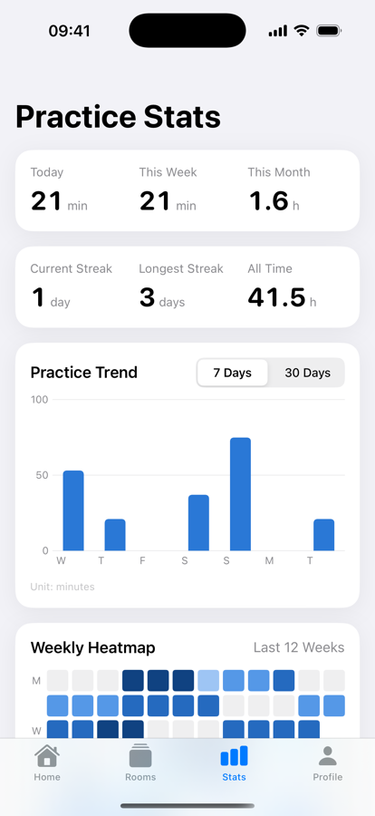
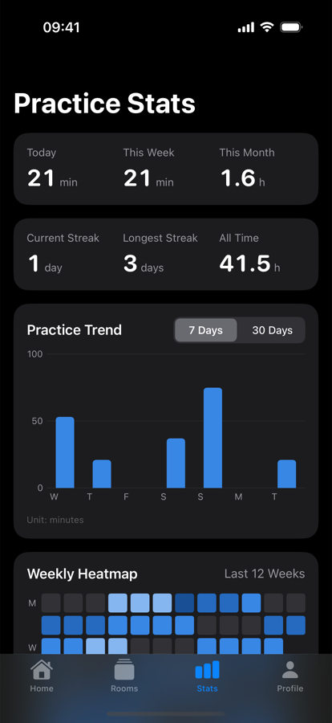
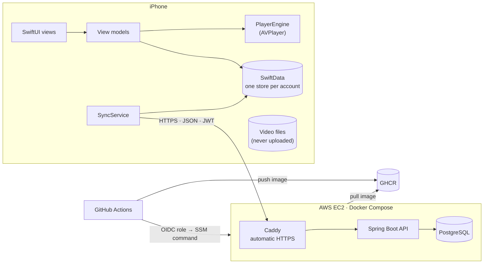

# Dance Practice

An iOS app for learning choreography from videos. Slow the video down, mirror it, loop the tricky eight counts, and keep track of how much you practise, with an optional account that syncs your rooms and practice history across devices through a Spring Boot backend running on AWS.

[](https://github.com/RRRRAN704/dance-practice/actions/workflows/backend.yml)


**Live API:** <https://dance-api.flowbiterp.site/swagger-ui/index.html>

<p>
  
  
  
  
</p>

## Features

**Player** (the core of the app)
- Playback speed from 0.25x to 2.0x, set when the finger lifts so the video never stalls mid-drag
- One-tap mirroring, so you can follow a dancer facing you
- A-B loops with draggable markers on a thumbnail timeline
- Fullscreen that follows the video's orientation, with auto-hiding controls; rotate the phone to enter or leave

**Practice tracking**
- One practice room per video, with artist, genre and notes
- Counts only the time the video is actually playing
- Home: today, this week and the current streak. Stats: trend chart, 12-week heatmap and time per genre (Swift Charts)

**Accounts and sync**
- Works fully offline as a guest; sign in to sync rooms and practice history between devices
- Each account gets its own local store; guest data can be imported into an account without duplicates
- Videos stay on the device (only metadata syncs); a synced room on a new device asks you to pick the video again
- In-app account deletion removes the cloud data and the local copy

**Polish**
- English and Simplified Chinese, following the device language
- Light and dark mode; chart colours checked for colour-vision deficiencies

## Architecture



### iOS
- **Layers kept apart:** views only render state; view models own the logic; `PlayerEngine` wraps AVFoundation; storage and networking sit behind small types. The player doesn't know about SwiftData: it reports practice time through a callback, and the screen that hosts it saves the session.
- **Pure, tested logic:** practice timing, streak and stats maths, A-B loop rules and the sync merge are plain functions with unit tests.
- **No third-party dependencies:** SwiftUI, SwiftData, AVFoundation, Swift Charts, Keychain and URLSession only.
- **Localisation:** English source strings in code, translations in a String Catalog. Shared components take `LocalizedStringResource` so labels passed into them are still translated, and dates and weekday names come from the user's locale.

### Backend
- **Java 21, Spring Boot 3.5, PostgreSQL 16**, with Flyway migrations and Spring Data JPA, plus JdbcTemplate for the stats SQL.
- **Auth:** short-lived JWT access tokens and rotating refresh tokens, stored hashed. Reusing an old refresh token is treated as theft and signs the user out everywhere.
- **Sync in one endpoint:** a device pushes its changes and pulls everything newer than its cursor in a single transaction.
  - The cursor comes from a Postgres sequence, so device clocks never decide what's new.
  - A per-user row lock stops a slow sync from committing behind a cursor that has already moved on.
  - Rooms are last-write-wins; deletions are permanent tombstones.
  - Ids are generated on the device, so a retried request is harmless.
- **Errors** follow RFC 9457 (`application/problem+json`).
- **Integration tests run against a real Postgres** in Testcontainers.

More detail: [backend/README.md](backend/README.md).

### Deployment
- A multi-stage Dockerfile builds the API (JDK to compile, JRE-only image running as a non-root user).
- One EC2 instance runs Caddy, the API and Postgres with Docker Compose. Only Caddy is reachable from outside, and secrets live in a server-side `.env` that never enters git.
- Every push to `main` that touches the backend: run the tests, build and push the image to GHCR, then deploy.
  - **No long-lived credentials.** GitHub's OIDC token is exchanged for an AWS role that can only send commands to that one instance, and only from this repository's `main` branch. The server pulls the image with the job's own short-lived token.
  - **SSH stays closed to the internet**; the deploy goes through AWS Systems Manager.
  - **Automatic rollback:** the deploy waits for the new container's health check and switches back to the previous image if it fails.
- **Daily database backups** ([`backup.sh`](backend/deploy/backup.sh)): cron runs `pg_dump` at 03:00 UTC, checks the dump is readable, keeps 7 days on the server and uploads it to S3.
  - The server's role can put and read backups but **not delete them**, and the bucket is versioned, so a compromised server can't destroy the history. A lifecycle rule expires backups after 30 days.
  - **Restore drill** ([`restore-drill.sh`](backend/deploy/restore-drill.sh)): restores the newest S3 backup into a throwaway Postgres container and compares every table's row count with production.

## Repository layout

```
ios/DancePractice/          Xcode project
  DancePractice/
    Features/               Screens: Home, Rooms, Player, Stats, Profile, Account
    Player/                 PlayerEngine (AVFoundation), PracticeTimer, thumbnails
    Models/                 SwiftData models
    Storage/  Sync/         Per-account stores, guest import, sync client
    Networking/  Account/   API client, Keychain, sign-in
    Shared/                 Theme, reusable components, stats maths, formatting
    Localizable.xcstrings   English + Simplified Chinese
backend/                    Spring Boot API, Dockerfile, deploy/ (production compose + Caddy)
.github/workflows/          CI/CD
```

## Running it locally

**Backend** (needs Docker; JDK 21 only if you run it outside Docker):

```bash
cd backend
docker compose --profile full up -d --build    # Postgres + API on http://localhost:8080
# or, for development: docker compose up -d && ./mvnw spring-boot:run
./mvnw verify                                  # tests, using Testcontainers
```

**iOS** (Xcode 16+, iOS 17+ simulator): open `ios/DancePractice/DancePractice.xcodeproj` and run. Debug builds talk to `localhost:8080`; add the launch argument `-productionAPI` to use the live server instead. In Debug builds, `-sampleData` starts with an in-memory store full of demo rooms and sessions.

## Tests

- **iOS:** about 90 unit tests (Swift Testing) for timing, stats, loops, formatting, sync merging and SwiftData behaviour.
- **Backend:** about 30 integration tests (JUnit 5 + Testcontainers) covering auth, sync conflicts, ownership checks and stats SQL. CI runs them on every change.

## Roadmap

- Rate limiting, email verification and password reset
- Metronome and BPM-aligned loops (count-in "5, 6, 7, 8")
- Record yourself and compare side by side with the original
- Optional video upload to S3 with presigned URLs
